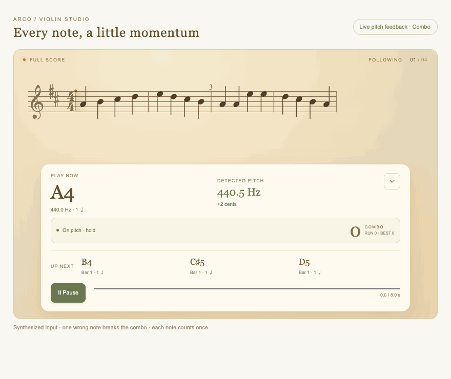
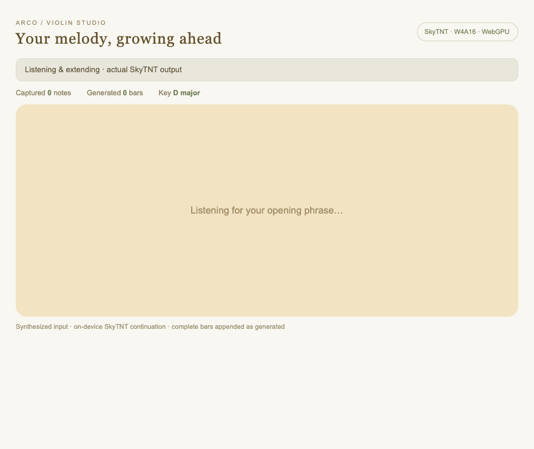

# ARCO · Violin & Guitar Studio

A responsive React violin and guitar tuner with English and Chinese support, faster pitch tracking, a separate metronome practice mode, and local MusicXML/MXL/MIDI score practice with live pitch and timing analysis, plus guided beginner bowing and fingering exercises. The application source lives in [`violin-tuner`](violin-tuner).

Vibe mode listens to an improvised melody and continuously extends the score ahead, publishing complete bars as they arrive while retaining the full score. Rule-based continuation is the default; optional SkyTNT Transformer inference uses INT4 weights, FP16 compute and WebGPU on the device. Its 144.5 MB of weights are hosted with the site and downloaded only on request, verified and cached as resumable shards. Performed notes and generated revisions retain their engine IDs for review and export. See the [deployment and model details](violin-tuner/public/models/skytnt-tv2o-medium-w4a16-stable-v2/README.md).

Reference tones, beginner/score practice, and Vibe continuations can be auditioned with real solo-violin samples. Playback supports pause/resume, score-position seeking, fullscreen controls and the selected A4 tuning. Samples are hosted with the app; see [sample credits](violin-tuner/public/audio/violin/README.md).

A separate [SkyTNT pretrained-model evaluation](violin-tuner/evaluations/skytnt/README.md) includes verified native inference measurements, constrained violin decoding, and MIDI/MusicXML examples. Its [W4A16 + WebGPU priority path](violin-tuner/evaluations/skytnt/WEBGPU.md) now includes converted-weight and real desktop-browser precision/latency comparisons.

Score practice includes a graded library of nine openly licensed or public-domain practice editions. See the [score credits and licenses](violin-tuner/public/scores/SOURCES.md).

## Demos

Pitch hits, missed notes and combo feedback in score practice:



Vibe extending a melody with **SkyTNT W4A16 + WebGPU**:



Both demos use synthesized input and the application's score/HUD components. The Vibe clip uses actual on-device SkyTNT inference, not rule-based output; see the [capture details and inference log](docs/demos/README.md).

## Instrument switching

Use the instrument selector in the header to switch between violin and guitar. The choice is remembered locally. Switching stops active microphones, playback and practice; saved Vibe takes remain in the history for their instrument.

- Guitar standard tuning: E2–A2–D3–G3–B3–E4, with low-frequency detection down to 65 Hz and the same 60 Hz analysis cadence.
- Fret practice covers open strings and four consecutive frets, starting at frets 1–12. Auto-detection prefers the current string for unisons.
- Three guitar beginner lessons cover open-string plucking, high-string changes, and chromatic fretting. Score practice, hit/combo feedback, fullscreen notation, metronome and Vibe work with either instrument.
- Guitar reference tones and score/Vibe previews use a locally synthesized plucked-string voice; violin retains its sampled voice. Guitar voices are prepared before playback to keep note scheduling responsive.
- Guitar Vibe captures E2–E6 and constrains continuations to E2–E5, using the acoustic-guitar program for SkyTNT. Violin defaults remain unchanged. New takes record the instrument; older takes are treated as violin.
- Scores use concert pitch, including guitar exercises; this version follows single notes rather than chords and does not generate guitar tablature. Microphone accuracy still depends on the instrument, room and device.

## Development

```sh
cd violin-tuner
npm ci
npm run dev
```

## Checks

```sh
npm run format
npm run format:check
npm test
npm run build
```

## GitHub Pages

The [CI and GitHub Pages workflow](.github/workflows/pages.yml) checks formatting, runs tests, and builds every pull request. Pushes to `main` also publish the application to GitHub Pages:

https://allegro0132.github.io/orchestrator/

In repository **Settings → Pages → Build and deployment**, select **GitHub Actions** as the source. Deployment uses the built-in `GITHUB_TOKEN` and requires no personal access token or repository secret.

The workflow sets `VITE_BASE_PATH=/orchestrator/` for project-site assets. Ordinary local and Sites builds keep `/` as their base. To reproduce the Pages build locally:

```sh
cd violin-tuner
VITE_BASE_PATH=/orchestrator/ npm run build
VITE_BASE_PATH=/orchestrator/ npm run preview
```

Microphone input requires HTTPS or localhost. Audio stays on the device.
